<p align="center">
  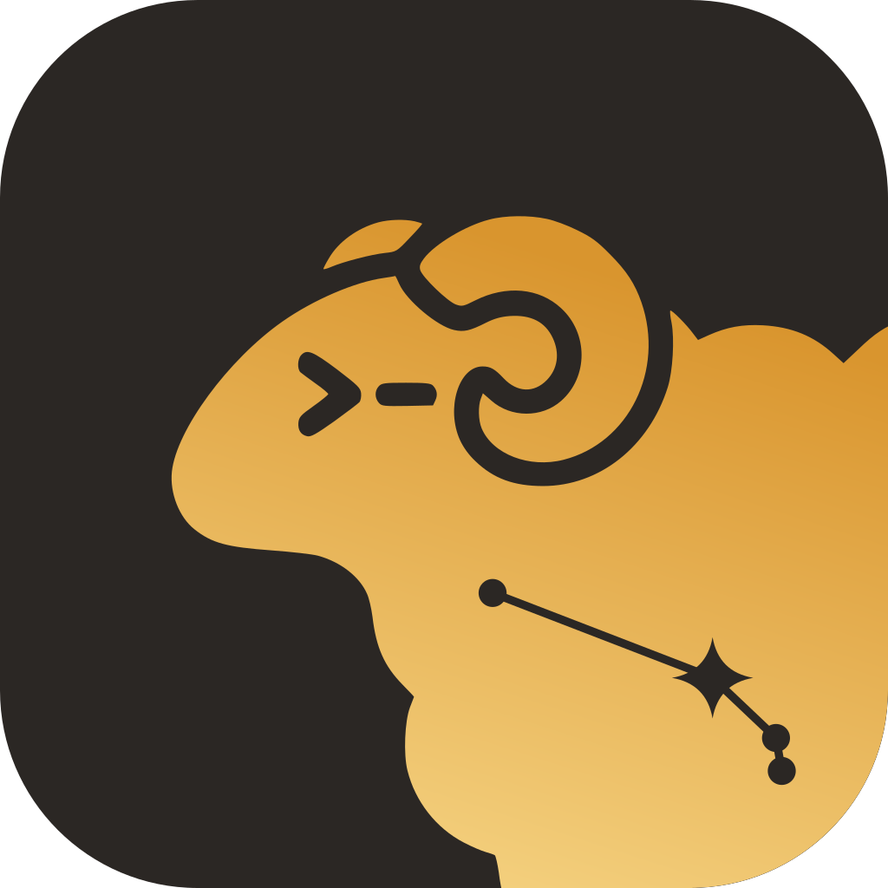
</p>

<h1 align="center">Aries</h1>

<p align="center">
  <strong>Your Herdr agents, in your pocket.</strong><br>
  A native Android app for the coding agents running on your own computers.
  See which Agent needs you, answer it, read its Chat, or type into its Terminal,
  all over plain SSH.
</p>

<p align="center">
  <a href="LICENSE"></a>
  
  
</p>

<p align="center">
  <a href="https://shiro-el.github.io/aries/">Website</a> ·
  <a href="#install">Install</a> ·
  <a href="#connect-your-first-host">Connect a Host</a> ·
  <a href="CONTRIBUTING.md">Contributing</a>
</p>

Aries is a phone client for [herdr-core](https://github.com/herdrdev/herdr-core), the [Herdr](https://github.com/herdrdev/herdr) project's terminals for coding agents. You leave Claude Code, Codex, OpenCode or Pi working on a Host (any computer running herdr-core); Aries shows you the same Spaces, Tabs and Panes as the Herdr desktop app, with each Agent's status, so you can step away and still answer when an Agent is Blocked.

The phone talks to the Host over **SSH** and runs `herdr-core connect` there. Nothing new listens on the Host, and terminal traffic never passes through a server of ours. SSH and herdr-core are all a Host needs to list Agents, open Terminals, browse files, and read Git changes. The optional **Beacon** (`aries-beacon`), which the app can install and update over SSH, adds Chat, Calls, Call history and push notifications.

Aries is an independent project. It is not made, maintained or endorsed by the Herdr project or its authors.

## Contents

- [Preview](#preview)
- [What you can do](#what-you-can-do)
  - [See every Agent](#see-every-agent)
  - [Read and answer in Chat](#read-and-answer-in-chat)
  - [Work in a Terminal](#work-in-a-terminal)
  - [Files, Git and GitHub](#files-git-and-github)
  - [Notifications and Calls](#notifications-and-calls)
  - [Outside the app](#outside-the-app)
  - [Connect safely](#connect-safely)
  - [Make it yours](#make-it-yours)
- [Install](#install)
- [Connect your first host](#connect-your-first-host)
- [How it works](#how-it-works)
- [Development](#development)
- [License](#license)

## Preview

Screens from the current app, filled with made-up data.

<table>
  <tr>
    <td width="50%" valign="top">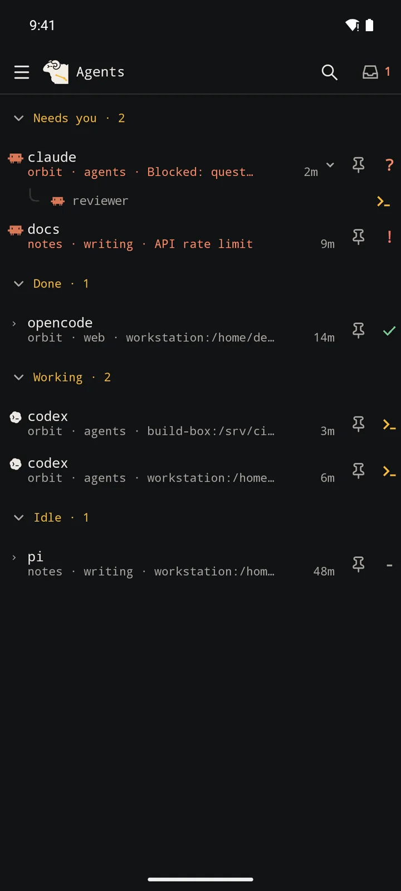<br><strong>Agents</strong><br>Every Agent on every Host, grouped by what it needs from you.</td>
    <td width="50%" valign="top">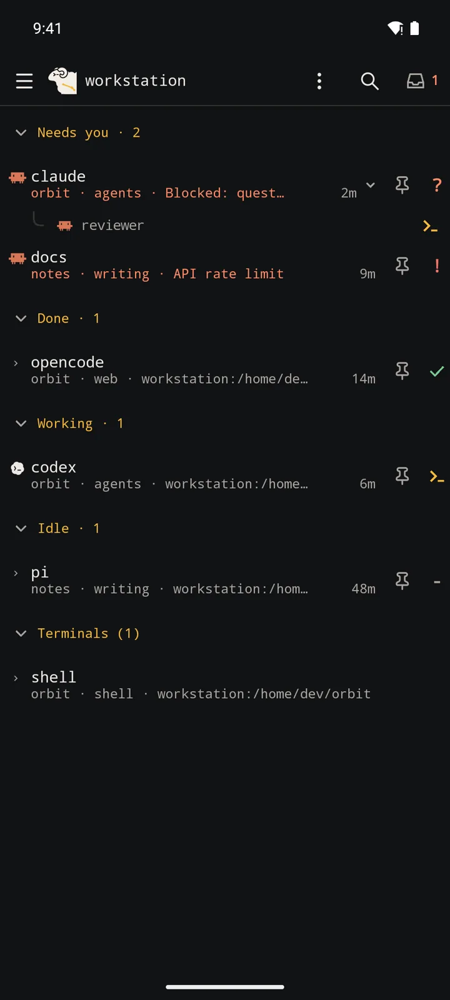<br><strong>Browse a Host</strong><br>Spaces, Tabs and Panes as the desktop lays them out, sub-agents under their parent.</td>
  </tr>
  <tr>
    <td valign="top">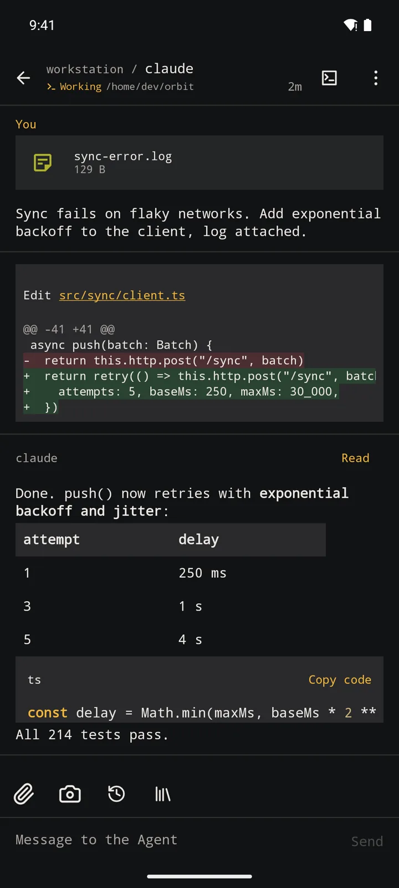<br><strong>Chat</strong><br>The Agent's own transcript: Markdown, tables, code, diffs and attachments.</td>
    <td valign="top">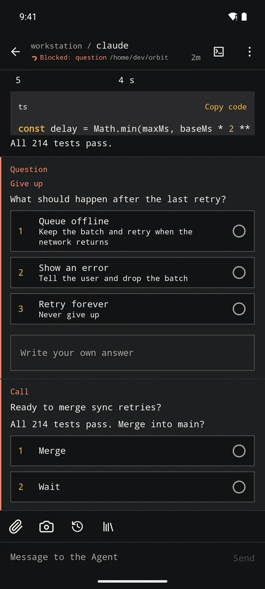<br><strong>Answer</strong><br>Pick an answer to a question or a Call with one tap, or write your own.</td>
  </tr>
  <tr>
    <td valign="top">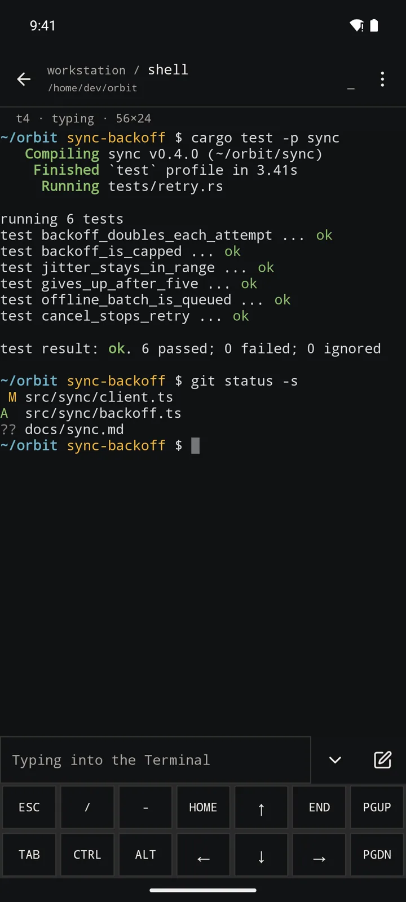<br><strong>Terminal</strong><br>A real terminal with two rows of extra keys and sticky Ctrl and Alt.</td>
    <td valign="top">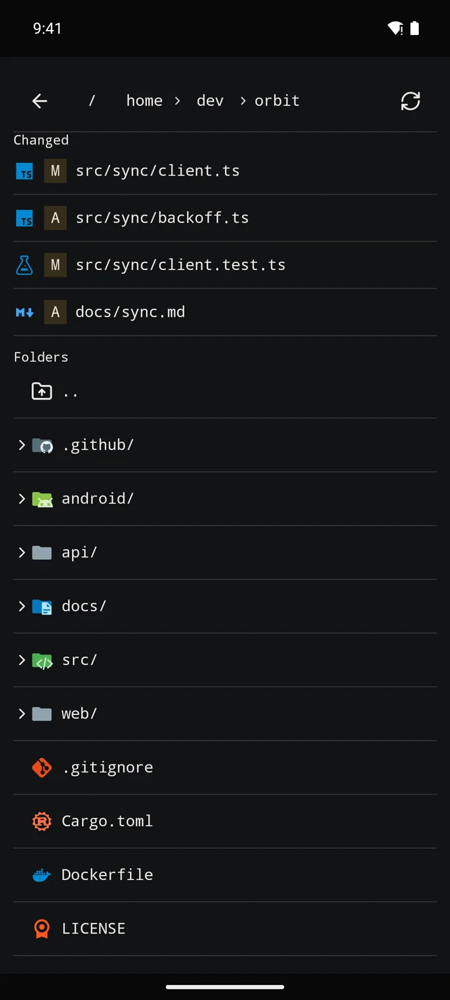<br><strong>Files</strong><br>Changed files first, then the folder, each with its file-type icon.</td>
  </tr>
  <tr>
    <td valign="top">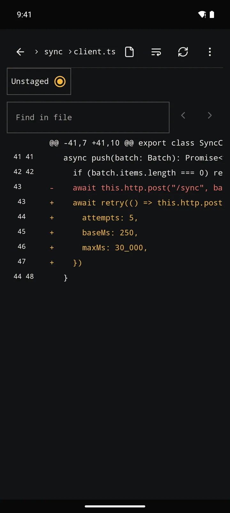<br><strong>Git changes</strong><br>Read-only diffs with line numbers; send a selection to the Chat draft.</td>
    <td valign="top">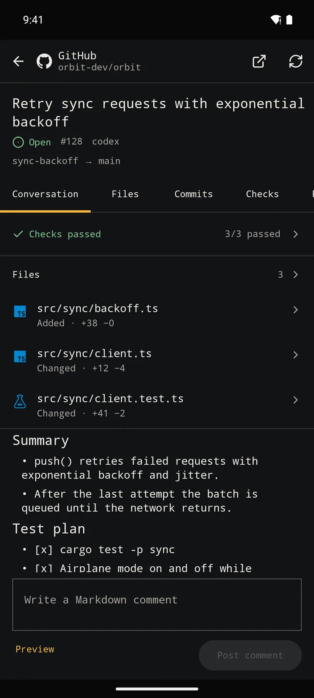<br><strong>GitHub</strong><br>Issues and pull requests through the Host's own <code>gh</code>.</td>
  </tr>
  <tr>
    <td valign="top">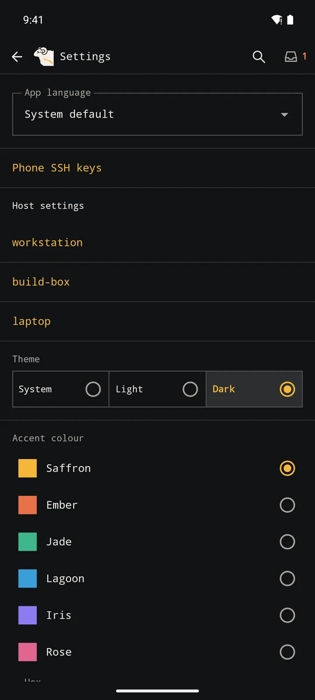<br><strong>Settings</strong><br>Language, theme, accent colour, keys and per-Host settings in one place.</td>
    <td valign="top">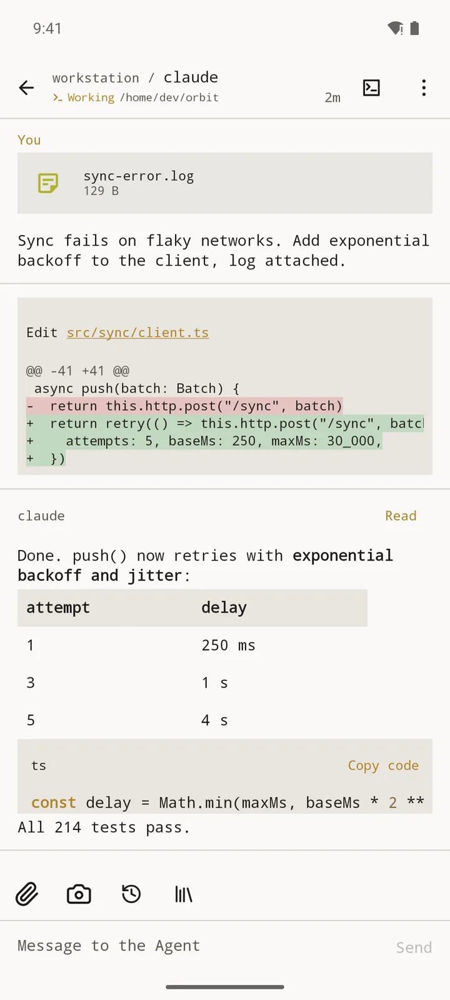<br><strong>Light theme</strong><br>Every screen follows the system, or a theme you pick.</td>
  </tr>
</table>

## What you can do

### See every Agent

- One list of the Agents on all your Hosts, grouped by Agent status: **Blocked** and **Error** (needs you), **Working**, **Done** and **Idle**, with how long each has been in it.
- Browse a Host the way herdr-app shows it: Spaces, Tabs and Panes, with sub-agents under the Terminal that started them. Create, rename and close Spaces and Tabs, and end Terminals.
- Start a Terminal or an Agent from a preset or a saved launch, choosing the folder, model and effort; open one in a Git worktree.
- Pin Agents, fold groups, and jump anywhere with quick open and the command palette.
- Aries reconnects after a network change and returns you to the screen you were on, even after a restart.

### Read and answer in Chat

Chat works for **Claude Code, Codex, OpenCode and Pi** (it needs the Beacon on the Host).

- Read the conversation from the Agent's own transcript rather than its terminal screen: Markdown, tables, highlighted code, Mermaid diagrams, diffs, images and tool results with their details.
- Answer an Agent's question with one tap, or write your own answer. Pending and earlier questions stay answerable.
- Send messages with newlines, slash-command completion and skill search. Attach photos, files or anything shared to Aries; they upload into the Terminal's folder on the Host and show as attachment cards.
- Search a Chat, select and copy messages, and keep your reading position with a **Latest** button to jump back.
- Read cached Chats offline (encrypted on the phone, kept 30 days by default), dictate with Groq Whisper using your own API key, and have replies read aloud with the system voice.

### Work in a Terminal

- Watch a Terminal without resizing it on the desktop; start typing and Aries attaches for input.
- Two rows of extra keys (Esc, Tab, arrows, Home/End, PgUp/PgDn) with **Ctrl** and **Alt** that stay on until you turn them off.
- Edit a command in the composer and send it at once, reuse recent input, and type Korean with the regular keyboard.
- Scroll back, pinch to zoom, search the output, copy, or send a selection to the Agent's Chat draft.
- Pick the terminal font and size, and a minimum contrast.

### Files, Git and GitHub

- Browse the Host's files and open them read-only with syntax highlighting, a wrap toggle, find in file and file-type icons. Images, SVG and PDF open in a viewer.
- Save a Host file to the phone or send it to another app.
- See the Git changes in an Agent's folder and read each diff.
- With `gh` signed in on the Host: list and search issues and pull requests, read and post comments, close and reopen issues, and check a pull request's files, commits, checks and reviews. No GitHub token is stored on the phone.

### Notifications and Calls

These need the Beacon and a push Relay (see [How it works](#how-it-works)).

- Get notified when an Agent becomes Blocked or hits an Error; choose which statuses notify you, per Host. Tap a notification to open that Agent.
- Answer an Agent's question from the notification, reply inline, or mark it seen or for later.
- Follow a Working Agent's progress in an ongoing notification (a Live Update on Android 16+).
- **Calls**: Agents can ask for you explicitly through the `aries-call-human` skill the Beacon installs. Each Call has an urgency (its own notification channel) and up to three Choices you can pick right from the notification. Call history keeps every Call.
- Quiet hours silence routine notifications; Emergency Calls still ring.

### Outside the app

- Home screen widgets (2×1 and 4×2) and a Quick Settings tile show who needs you.
- Launcher shortcuts start your saved launches.
- Wear OS: notifications with their own vibration, a tile and a complication for Agents waiting on you.

### Connect safely

- Aries makes its own ed25519 SSH key, kept with Android Keystore; you can require biometric unlock for it. Or import an existing OpenSSH key.
- Host keys are confirmed on first connection and a changed key stops the connection.
- Reach Hosts through one or more jump hosts, each with its own key.
- Lock the whole app behind device unlock.
- Diagnostics show recent connection and push events.

### Make it yours

- English or Korean, following the system or chosen in the app.
- System, light or dark theme, and an accent colour.

## Install

There is no published release yet. Signed builds will appear on [GitHub Releases](https://github.com/shiro-el/aries/releases) once the release pipeline goes live; until then, build Aries from source.

You need Rust (stable, 1.99+), Java 21 and the Android SDK with NDK 27.1.12297006.

```sh
git clone https://github.com/shiro-el/aries.git
cd aries
rustup target add aarch64-linux-android x86_64-linux-android
cargo install cargo-ndk
export ANDROID_HOME=$HOME/Android/Sdk
export ANDROID_NDK_HOME=$ANDROID_HOME/ndk/27.1.12297006

cd android
./gradlew :app:assembleDogfood -Paries.abis=arm64-v8a      # optimized build for a phone
adb install app/build/outputs/apk/dogfood/app-dogfood.apk
./gradlew :wear:assembleDogfood                              # optional: the Wear OS app
```

A build from source differs from a release in two ways:

- **Beacon**: the app installs only the Beacon binaries a release pins by checksum, so a plain source build cannot install one. Build the Beacon yourself as described in [CONTRIBUTING.md](CONTRIBUTING.md#releases) if you need Chat, Calls or push now.
- **Push**: notifications need your own Firebase project (`android/app/google-services.json`) and a Relay. Without them the app tells you push is unavailable. See [relay/README.md](relay/README.md) to run your own Relay.

## Connect your first host

On the Host you need SSH and [herdr-core](https://github.com/herdrdev/herdr-core) 0.1.17 or newer. If herdr-core is missing, Aries can install a checksum-pinned copy from the Host's settings.

1. **Get a key on the phone.** Until it has one, **Add Host** points you to **Phone SSH keys** in Settings: choose **Create SSH key**, or **Import existing key** to use an OpenSSH key you already have.
2. **Add the Host.** Enter its address, port and user name, then confirm the Host key fingerprint the first time you connect.
3. **Authorize the key**, in whichever way suits you:
   - **Install key**: log in once with the account's password and Aries adds its public key to `~/.ssh/authorized_keys`. The password is not saved.
   - **Copy public key** or **Show QR code**, and add it to `authorized_keys` yourself.
   - **Scan Host QR**: with `aries-beacon` on the Host, run `aries-beacon pair-qr --address <address> --port 22` there and scan the code. It registers the Host and authorizes this phone in one step and expires after five minutes. Details are in [CONTRIBUTING.md](CONTRIBUTING.md#registering-a-host-with-a-qr).
4. **Behind a bastion?** Open the Host's settings → **Jump hosts** and add each hop, with its own key if needed.
5. **Optional: Beacon and push.** In the Host's settings, **Install Beacon**, then **Turn on push** and **Send a test notification**.

Tap the Host to see its Spaces, or open **Agents** for everything at once.

## How it works

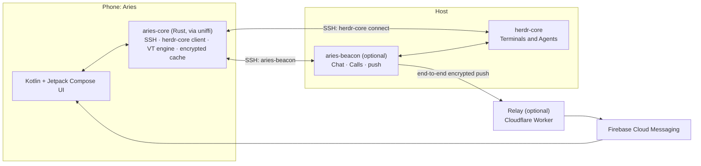

- **App**: a thin Kotlin and Jetpack Compose UI over `aries-core`, a Rust library called through [uniffi](https://github.com/mozilla/uniffi-rs). The core holds the SSH client, the herdr-core protocol client, the terminal emulator ([alacritty_terminal](https://github.com/alacritty/alacritty)), the Chat cache and the push decryption.
- **Host**: herdr-core runs the Terminals. The phone connects over SSH and speaks herdr-core's public protocol, so the Host's network exposure is just SSH.
- **Beacon** (`crates/beacon`): a small program on the Host. It reads each Agent's transcript for Chat, records Calls, delivers answers, and watches Agent status to send push notifications.
- **Relay** (`relay/`): a Cloudflare Worker that forwards encrypted push envelopes from a Beacon to the phone. It cannot read them and never stores them; you can run your own and choose it per Host.
- **Protocol** (`crates/protocol`): the formats the core and the Beacon share.

## Development

Layout, requirements, checks and the release process are in [CONTRIBUTING.md](CONTRIBUTING.md). The Relay has its own [README](relay/README.md).

## License

Aries is released under the [MIT License](LICENSE); see [NOTICE](NOTICE) for third-party notices. The logo set in [`assets/aries/`](assets/aries/), and images made from it such as the launcher icon, is excluded from the MIT License and has its own terms in [`assets/aries/LICENSE`](assets/aries/LICENSE). The screenshots show that logo.
